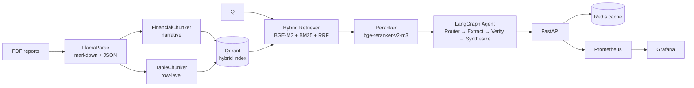
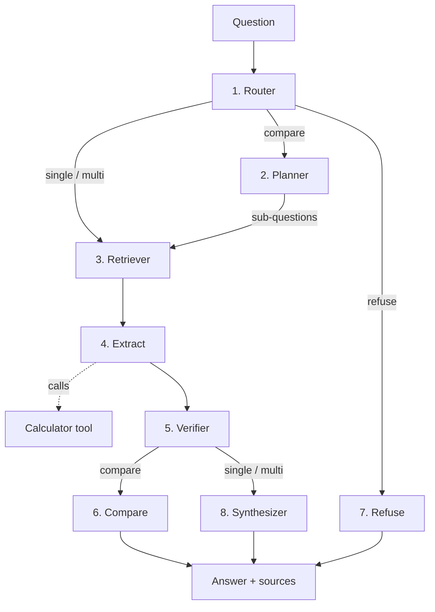
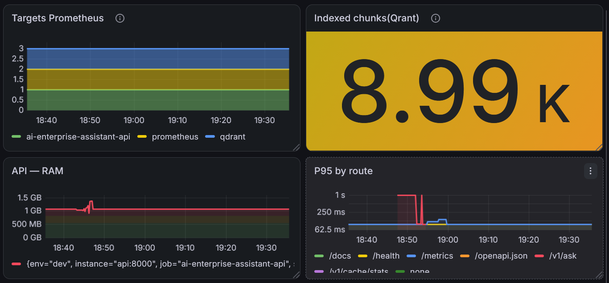

# 🏦 Enterprise AI Knowledge & Decision Assistant

[](https://github.com/ngahyves/Enterprise-AI-Decision-Platform/actions/workflows/ci.yaml)


> A RAG system that answers natural-language questions about the **2025 annual reports of RBC, TD, BMO, and Scotiabank** — 4 PDFs, ~300 pages each, dense financial tables. Built end-to-end: from PDF parsing to a secure API, with Prometheus + Grafana observability and a 25-test CI pipeline.

The interesting part isn't the stack. It's the **eight failures it took to get from R@10 = 0.14 to R@10 = 0.91**.

---

## Key Results

| Metric | Value | Notes |
|---|---|---|
| **Retrieval R@10** (Hybrid + Reranker) | **0.910** | vs 0.641 dense-only · +27 pts |
| **Retrieval MRR** (Hybrid + Reranker) | **0.799** | vs 0.306 dense-only · ×2.6 |
| **Answer Faithfulness** (DeepEval) | **0.924** | Grounded in retrieved context |
| **Answer Relevancy** (DeepEval) | **0.992** | Responses address the question |
| **Corpus** | 1000 pages · 8 990 chunks · 4 banks · 50 questions (39 verified) | narrative + row-level |
| **Cached latency** | **2.05 s** | **47× speedup** vs cold (97.4 s) |

Evaluated on 39 manually verified questions from the 2025 annual reports.


## The Problem

Annual reports are a nightmare for naive RAG:

- **Tables are 60% of the answer.** "What was TD's PCL in 2025?" — the answer is a cell in a table, not a sentence in a paragraph.
- **PDFs destroy structure.** Standard extractors flatten tables into garbled text. Columns merge, headers vanish.
- **Numbers are indistinguishable.** `1,476,802` appears 7 times across the corpus (in summaries, footnotes, and audit notes). Which one is *the* answer?

A naive pipeline (PyMuPDF → fixed-size chunks → BGE-M3 → top-k) got **R@10 = 0.14**. That is, 86% of the time, the correct chunk was not in the top 10 retrieved.

Here's how I got from 0.14 to 0.91


## Architecture


---

## The Journey

### Iteration 1 — "Better parsing will fix it"

**Hypothesis:** PyMuPDF was destroying tables. A layout-aware parser should help.

**What I did:** Migrated to **LlamaParse** in JSON mode. Tables now come back as structured objects (`rows[]`, `headers[]`, `isPerfectTable`). 153 tables extracted for BMO, 299 for Scotia.

**Result:** R@10 = **0.19**. Barely moved. Parsing was necessary but not sufficient — the chunker still split 20-row tables across 3–4 chunks, so no single vector ever saw a complete metric.

**Lesson:** *The parser was the symptom, not the cause.*

---

### Iteration 2 — "Let's linearize the tables" (abandoned)

**Hypothesis:** Markdown tables `| metric | 2025 | 2024 |` produce weak embeddings. Convert each row to a natural sentence: *"Net income 2025: 21,522."*

**What I built:** `linearizer.py` — markdown → sentences via `markdown-it-py`.

**Result:** +0.03 R@10. **Abandoned.** The root problem wasn't the format, it was *dilution*: a chunk still averaged 50 sentences into one vector. One embedding can't represent 50 metrics.

**Lesson:** *A better average of 50 things is still an average of 50 things.*

---

### Iteration 3 — Dual-chunking (the breakthrough)

**Hypothesis:** Narrative prose and financial tables are **different content types** and should never share a chunk.

**What I built:** Two independent chunkers feeding one Qdrant index:

1. **`FinancialChunker`** — hierarchical split on markdown headers (`#`, `##`, `###`), then `RecursiveCharacterTextSplitter`. Filters out chunks where >50% of lines start with `|` (those go to the table chunker).
2. **`TableChunker`** — one chunk per table row. Each chunk is prefixed with `[Bank | Section | Metric]`, then the row values:
[BMO | FINANCIAL HIGHLIGHTS | Provision for credit losses]
2025: 3,617 | 2024: 3,050


**Result:** 8,990 chunks (vs 2,323 before) — **4× more, each 50× more focused.** R@10 = **0.70**.

**Lesson:** *The right chunk is the one where one vector = one concept.*

---

### The last mile — reranking

Even at R@10 = 0.70, the correct chunk was often at rank 6–10. A cross-encoder (`bge-reranker-v2-m3`) reordered the top-50 down to top-10 and pushed the correct chunk to rank 1 in most cases.

**Result:** R@10 = **0.910**. MRR = **0.799** (from 0.306 with dense-only).

**Key insight:** The reranker doesn't *find* new chunks — it only reorders. So R@10 = R@20 = R@50 after reranking (fixed top-10 set). The real metric is **MRR**: ×2.6. That's the reranker's entire contribution.

---

## Three bugs that cost me a full day each

These are the debugging stories that don't show up in metrics.

### Bug 1 — Scotia scored R@10 = 0.00 for an entire week

**Symptom:** All Scotiabank questions returned recall = 0.00. Every single one.

**Cause:** The ground truth used `expected_bank = "SCOTIABANK"`. Qdrant's payload stored `bank_name = "SCOTIA"`. The bank filter returned **zero chunks** for every Scotia question.

**Fix:** Canonical alias table, applied both in the retriever and the eval:

```python
BANK_ALIASES = {"SCOTIABANK": "SCOTIA", "SCOTIA": "SCOTIA", ...}
```

### Bug 2 — The ground truth was 40% wrong

**Symptom:** After re-chunking, R@10 dropped to 0.21 on the same pipeline that scored 0.70 before. Nothing in the code had changed.

**Cause:** Chunk IDs shift when you re-index. The auto-mapped ground truth matched chunks by keyword overlap — chunks with "net income" but the wrong number passed validation. **40% false positives.**

**Fix:** Manual verification of 39/50 questions. For each, extract the distinctive numeric values from the reference answer, find those values in chunks, inspect the top candidates by hand.

**R@10: 0.21 → 0.70**. The pipeline was fine. The measurement was broken.

Now covered by: tests/test_ground_truth.py (asserts 50 questions, 39 verified, no duplicates).

### Bug 3 — Near-duplicate chunks poisoned the recall

**Symptom:** BMO chunk_140, chunk_372, chunk_57, and chunk_322 all contained 1,476,802 (same value, different sections). The ground truth pointed to one. The retriever returned another. Recall = 0.

**Fix:** Ground truth now accepts multiple relevant chunks per question. Near-duplicates verified manually and added.

**BMO R@10: 0.05 → 0.23. A real +0.18 gain on 3 questions.**


## The results

### Retrieval — 4 architectures, 39 verified questions

| Architecture | R@10 | MRR | Verdict |
|---|---:|---:|---|
| Dense (BGE-M3) | 0.641 | 0.306 | Baseline |
| Sparse (BM25) | 0.385 | 0.247 | Weak on financial prose |
| Hybrid (RRF, k=60) | 0.705 | 0.261 | +6 pts over dense |
| **Hybrid + Reranker** | **0.910** | **0.799** | **The full pipeline** |

### Generation — DeepEval, Gemini judge

| Metric | Score | What it means |
|---|---:|---|
| Faithfulness | **0.924** | Answers grounded in retrieved context |
| Answer Relevancy | **0.992** | Responses address the question |
| Contextual Recall | 0.543 | See honest note below |

On the 0.543 Contextual Recall: Reference answers contain 4–6 claims each (value, delta, %, prior year, source). Top-5 retrieval covers 3–4 of them. The rest sit in adjacent chunks the reranker skips. Increasing top-K to 8–10 would push this to ~0.75 — at +40% latency, which I couldn't afford (see below). Honest trade-off, documented.

## The API — one question, 8 nodes

`POST /v1/ask` doesn't call an LLM directly. It runs a **LangGraph state machine** where each node has a single responsibility. This is why the system is debuggable: when an answer is wrong, LangSmith shows *which node* failed.


| # | Node | Type | Latency | Responsibility |
|---:|---|---|---:|---|
| 1 | **Router** | Rules (no LLM) | 0.00 s | Classifies task type: `single` / `multi` / `compare` / `refuse` |
| 2 | **Planner** | Rules | ~0 s | Decomposes `compare` questions into per-bank sub-questions |
| 3 | **Retriever** | Hybrid + Reranker | **124.6 s** | Hybrid search (BGE-M3 + BM25 + RRF) → rerank top-50 → top-10 |
| 4 | **Extract** | Groq `gpt-oss-20b` | 1.07 s | Extracts structured facts `{bank, metric, value, source_chunk_id}` — calls the Calculator tool for derived values (deltas, YoY %) |
| 5 | **Verifier** | Deterministic | 0.70 s | Every fact must be backed by a quote from a retrieved chunk |
| 6 | **Compare** | Groq `gpt-oss-120b` | ~2 s | Merges per-bank facts into a side-by-side comparison |
| 7 | **Refuse** | Deterministic | 0.00 s | Returns "I don't have enough evidence" when verifier confidence is too low |
| 8 | **Synthesizer** | Groq `gpt-oss-120b` | 4.21 s | Writes the final natural-language answer from verified facts |

Total measured: ~97.4 s, of which ~99% is the Retriever (see latency analysis below).

## The hard truth about latency

My first measurement: **130 seconds per query**. Hypothesis: the 4 LLM calls are slow.

I profiled with LangSmith, node by node:
| Step | Time | % of total |
|---|---:|---:|
| Retriever (hybrid + reranker) | **124.6 s** | **~98%** |
| Extract (Groq `gpt-oss-20b`) | 1.07 s | ~1% |
| Verifier (deterministic) | 0.70 s | ~1% |
| Synthesizer (Groq `gpt-oss-120b`) | 4.21 s | ~3% |

The LLMs weren't the problem. The CPU cross-encoder reranker (bge-reranker-v2-m3, 568M params, mDeBERTa-v3-large) was doing 50 pair-scores × 512 tokens each × 1.9 s/pair ≈ 95 s of quadratic attention on CPU.
What I tried to fix it
| Attempt | Latency | R@10 | MRR | Verdict |
|---|---:|---:|---:|---|
| **Baseline** (`max_len=512`, `batch=32`) | 97.4 s | **0.91** | **0.79** | ✅ **Kept** |
| `max_len=256` | 63.8 s (−35%) | 0.88 | 0.68 | ❌ −0.12 MRR |
| Cascade MiniLM→BGE (K=10) | 31 s (−68%) | 0.76 | 0.71 | ❌ Ceiling at R@10 = 0.76 |
| 8-bit quantization | — | — | — | ❌ Native crash on Windows |

**Structural discovery**: **the cascade** can never exceed R@K of the hybrid retriever. With K=10, ceiling is 0.76. With K=20, ceiling is 0.81. To reach 0.91, BGE must see all 50 candidates → 97 s is unavoidable on CPU.

* The actual fix: Redis cache

| Metric | Value |
|---|---:|
| Cold latency | 97.4 s |
| Cached latency (backend) | 0.0 ms |
| Cached latency (wall, HTTP) | 2.05 s |
| **Speedup** | **47×** |

The cache turns a demo-only system into something usable for repeated questions. It's not a fix for cold-path latency — it's a mitigation that makes the project viable for portfolio demos.

In production: a GPU (T4/A10) drops the reranker to <500 ms. ONNX Runtime gets to ~40 s on CPU without quality loss. Both are documented in the roadmap, neither is deployed.

## The systems work

### Why 8 nodes instead of one big prompt?

**Debuggability** — when an answer is wrong, LangSmith shows exactly which node failed: wrong chunk retrieved? bad extraction? hallucinated synthesis? Without nodes, it's a 6,000-token prompt and you're blind.

**Model specialization** — gpt-oss-20b is fast and good at structured extraction. gpt-oss-120b is slower but better at synthesis. Using one model for both wastes either speed or quality.

**Deterministic guardrail** — the Verifier runs before the Synthesizer. Facts not grounded in a quote are rejected before the synthesiser can hallucinate on them.

**Refusal** is a first-class path — the Refuse node is explicit. If the evidence is weak, the system says so instead of guessing. This is what makes the difference between a RAG demo and a RAG system you can trust.

**Calculator tool** — financial answers need arithmetic (deltas, percentages, YoY). Delegating to a tool keeps the LLM from making arithmetic mistakes.

---

Once the retrieval was decent, the engineering around it mattered.

* Security — Unicode NFKC sanitization, 14 regex injection patterns (ignore previous, DAN, [INST]…), per-API-key rate limiting (10/min), and rejection before cache so a malicious input never touches Redis.

* Observability — Prometheus + Grafana provisioned as code. 9 panels: targets health, chunk count, P95 latency per route, error rate, RAM, plus a Markdown "Evaluation Summary" panel that displays the tables above without needing traffic.


* CI — 25 pure tests on GitHub Actions in <2 seconds. No Docker, no models, no PDFs needed. The 4 API tests stay local because they need a live server (97 s cold path — not CI material).

* Test isolation — the app's real lifespan loads 7 GB of models. Tests override it with a fake that boots in milliseconds. This is why pytest tests/api/ runs in 300 ms instead of 2 minutes.

## Stack

| Layer | Choice |
|---|---|
| **Orchestration** | LangGraph (router, extractor, verifier, synthesizer) |
| **Vector store** | Qdrant — hybrid (dense + sparse + RRF) |
| **Embeddings** | `BAAI/bge-m3` (1024d, cosine) + BM25 (FastEmbed) |
| **Reranker** | `BAAI/bge-reranker-v2-m3` (568M, cross-encoder) |
| **LLM** | Groq — `gpt-oss-20b` (extract) + `gpt-oss-120b` (synthesize) |
| **API** | FastAPI + slowapi + API-key auth |
| **Observability** | Prometheus + Grafana (provisioned as code) |
| **Evaluation** | DeepEval (Gemini 3.5 Flash-lite judge) |
| **CI** | GitHub Actions (pytest on Python 3.11) |

## Quick Start

### Prerequisites

- **Docker Desktop** (or Docker Engine + Compose v2)
- **~10 GB free disk** (7 GB models + 38 MB PDFs + ~1 GB images)
- **~8 GB RAM** (models are lazy-loaded, but the reranker needs headroom)
- API keys (all free tier):
  - [Groq](https://console.groq.com) → `GROQ_API_KEY`
  - [LlamaCloud](https://cloud.llamaindex.ai) → `LLAMA_CLOUD_API_KEY`
  - [Google AI Studio](https://aistudio.google.com) → `GEMINI_API_KEY` (for DeepEval)

### 1. Clone and configure

```bash
git clone https://github.com/ngahyves/Enterprise-AI-Decision-Platform.git
cd Enterprise-AI-Decision-Platform
cp .env.example .env
# Edit .env — fill in API_KEY, GROQ_API_KEY, LLAMA_CLOUD_API_KEY, GEMINI_API_KEY
```
### 2. Start infrastructure first
```bash
# Qdrant + Redis only — gives the API something to talk to
docker compose up -d qdrant redis

# Wait ~10 seconds for Qdrant to be ready
docker compose ps qdrant    # status must be "running (healthy)"
```
### 3. Load chunks into Qdrant (one-time, ~1 min)
```bash
# The committed chunks (data/processed/chunks/*.jsonl) are embedded and loaded
docker compose run --rm api python -m src.retrieval.vector_store
```
Expected output: Loaded 8990 chunks into collection 'bank_reports'.

    - Why manual? Re-indexing re-runs BGE-M3 embeddings on 8,990 chunks (~3 min on CPU). Making it automatic would slow down every docker compose up. Run once, then forget it.
### 4. Start the full stack
```bash
docker compose up -d --build
```
First run takes ~10–15 min: the API downloads BGE-M3 (4.25 GB) + reranker (2.5 GB) from HuggingFace into the hf_cache volume. Subsequent runs are instant (models cached).

Watch progress:
```bash
docker compose logs -f api
# wait for: "Startup complete"
```
### 5.Verify
```bash
curl http://localhost:8000/health
# {"status":"ok","agent_ready":true,"cache_ready":true}

curl -X POST http://localhost:8000/v1/ask \
  -H "X-API-Key: $(grep API_KEY .env | cut -d= -f2)" \
  -H "Content-Type: application/json" \
  -d '{"question": "What was TD provision for credit losses in 2025?"}'
# First call: ~97 s (cold path). Second call: ~2 s (cached).
```


### URL	Purpose

http://localhost:8000/docs	FastAPI Swagger UI
http://localhost:8000/metrics	Prometheus metrics
http://localhost:9090	Prometheus UI
http://localhost:3000	Grafana (admin / admin)
http://localhost:6333/dashboard	Qdrant UI

Requirements: Docker Desktop, ~8 GB RAM, free-tier Groq/Gemini + LlamaParse keys.

No API keys? The 25 pure tests run offline:
```bash

pytest tests/test_guardrails.py tests/test_retrieval_metrics.py tests/test_ground_truth.py -v
```

Project structure
text

app/                FastAPI app — routes, auth, guardrails, cache, limiter
src/
  ingestion/        PDF parsing (LlamaParse) + dual chunkers
  retrieval/        dense, sparse, hybrid (RRF), reranker, vector store
  agents/           LangGraph nodes
  evaluation/       RAG metrics + DeepEval
tests/              25 unit tests + 4 API tests
data/
  raw/              Source PDFs (4 reports, ~38 MB)
  evaluation/       Ground truth v1/v2/v3
scripts/            Eval, benchmark, chunk inspection
grafana/            Provisioned datasources + dashboards
.github/workflows/  CI

## Honest limitations

    - 97 s cold latency. CPU-bound on the cross-encoder. Needs GPU or ONNX Runtime for production.

    - 0.01 req/s throughput. One user at a time in cold mode. Redis cache raises this to ~0.5 req/s.

    - No PII redaction. Acceptable for public annual reports. Required for customer data (PIPEDA, OSFI B-13).

    - 11/50 questions unverified. Ground truth v3 covers 39. The remainder need manual annotation.

    - Windows-specific 2s HTTP overhead on the cached path. Would be 50–200 ms on Linux with keepalive.

# Future improvements

- GPU deployment (reranker < 500 ms)

- ONNX Runtime for CPU (~40 s, no quality loss)

- Contextual chunk enrichment (IEEE BigData 2025: +27% MRR)

- PII redaction layer (Presidio + Canadian rules)

- Verify the 11 remaining ground-truth questions

- Migrate DeepEval judge to a local 7B model (drop Gemini dependency)

## Author:
NGAH Yves-Bernard-Simplice - ***Machine Learning Engineer***

## License
